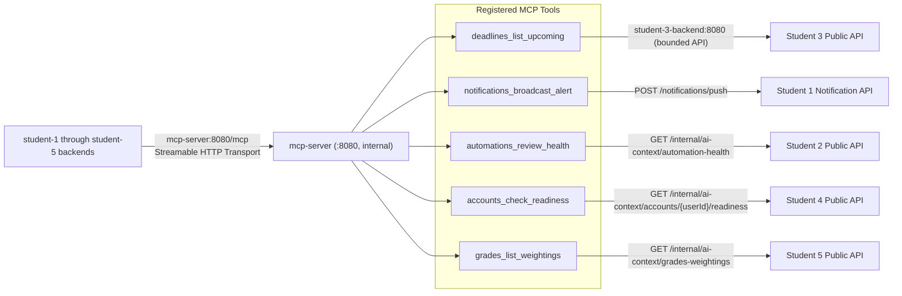

# MCP Server

Shared ASP.NET Core service for controlled Model Context
Protocol tools using the official C# MCP SDK and stateless Streamable HTTP
transport.



## Registered tools

### `deadlines_list_upcoming`

- Caller: `student-3-backend`
- Inputs: `days` (`1`-`90`), `limit` (`1`-`50`)
- Output: incomplete tasks due in the requested window
- Boundary: reads through Student 3's bounded HTTP API; it never accesses the
  Student 3 database service or volume directly

### `notifications_broadcast_alert`

- Caller: `student-1-backend`
- Inputs: `studentId` (non-empty UUID), `title` (3-100 characters),
  `message` (5-500 characters), and `urgency` (`Low`, `Medium`, `High`, or
  `Critical`; default `Medium`). Title and message are trimmed before validation;
  urgency is trimmed and case-insensitive.
- Output: created notification ID, target student ID, title, message,
  urgency, source (`mcp-server`), and delivery timestamp
- Boundary: writes through `POST /notifications/push` on Student 1's backend;
  it never accesses the notification database directly
- Errors: invalid inputs, unreachable/timed-out notification service, or an
  upstream notification error

### `automations_review_health`

- Caller: `student-2-backend`
- Input: `days` (`1`-`90`)
- Output: human-readable health assessment plus aggregate execution metrics
- Boundary: reads through Student 2's bounded HTTP API; it never accesses the
  Student 2 database file or exposes automation IDs or message content

### `accounts_check_readiness`

- Caller: `student-4-backend`, from the account profile UI
- Input: `userId`, a non-empty UUID
- Structured output: `status`, `tool`, `data`, `error`; data contains
  `userId`, `overallStatus`, `checkedAtUtc`, and four `checks`.
  Each check contains `code`, `label`, `status`, `message`, and `action`.
  Findings cover profile completeness, role configuration, Canvas gateway
  connectivity, and notification readiness; categories are `ready`,
  `needs_attention`, or `unavailable`.
- Boundary: read-only access through
  `GET /internal/ai-context/accounts/{userId}/readiness` on Student 4's backend.
  That backend probes only its configured Canvas gateway and notification
  service, and owns profile/role checks. No arbitrary service URLs,
  database access, account writes, personal field values, or credentials.
  Unavailable optional dependencies appear as findings, not missing checks.
- Errors: invalid UUID, account not found, unreachable/timed-out account
  service, or invalid upstream result
- Compose supplies `Student4__BaseUrl=http://student-4-backend:8080`.

### `grades_list_weightings`

- Caller: `student-5-backend`
- Inputs: `weight` (`0.01`-`1`, default `0.4`), `limit` (`1`-`10`, default `10`)
- Output: requested weight, result count, generation timestamp, and assignment
  items containing `assignmentId`, `name`, `weight`, and `maxMark`
- Boundary: reads through
  `GET /internal/ai-context/grades-weightings?weight={weight}&limit={limit}`
  on Student 5's backend; it never accesses the grades database service or
  volume directly
- Errors: invalid weight or limit, unreachable/timed-out grades service, or
  an invalid upstream response

## Running

Launch the shared services from the repository root:

```bash
docker compose up --build -d ai-mode mcp-server rag-server
```

There is no published host port. Callers on the `ai-services` network use
`http://mcp-server:8080/mcp`. MCP calls all five public backends using
`http://student-N-backend:8080`. Start the relevant feature backend to use
its tools.
