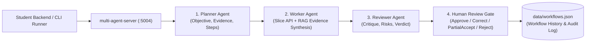

# Multi-Agent Server (`:5004`) — Non-Containerised Release 2 Shared AI Service

`multi-agent-server` is the shared non-containerised local ASP.NET Core (`.NET 10`) service that coordinates the **Planner -> Worker -> Reviewer -> Human Review** workflow for Release 2.

## Architecture & Roles



1. **Planner Agent**: Decomposes the user goal into an objective, required evidence sources, and step-by-step execution plan.
2. **Worker Agent**: Gathers live slice evidence (e.g., `student-1-backend` notifications and `rag-server` grounded policies) and synthesises a draft output and recommended actions via `ai-mode` (`:5001`).
3. **Reviewer Agent**: Audits the Worker output against the Planner objective and gathered evidence, flagging risks and confidence levels before pausing at `AwaitingHumanReview`.
4. **Human Review**: Records the final human decision (`Approve`, `Correct`, `PartialAccept`, or `Reject`), reviewer notes, and any corrected output into the immutable coordination audit log (`data/workflows.json`).

## Endpoints

| Method | Route | Purpose |
|---|---|---|
| `GET` | `/` | Service metadata, active agent list, and stored workflow count |
| `GET` | `/health/live`, `/health/ready` | Liveness and readiness probes |
| `GET` | `/api/workflows` | List workflow history (optional `?owner=student-1&studentId=...`) |
| `GET` | `/api/workflows/{id:guid}` | Retrieve a single workflow record and its coordination audit log |
| `POST` | `/api/workflows/run` | Execute `Planner -> Worker -> Reviewer` and pause at `AwaitingHumanReview` |
| `POST` | `/api/workflows/{id:guid}/human-review` | Submit Human Review decision (`Approve`, `Correct`, `PartialAccept`, `Reject`) |

## Running Locally

Launched automatically alongside `ai-mode`, `mcp-server`, and `rag-server`:
```bash
python tools/run_ai_services.py
```

Or run standalone:
```bash
dotnet run --project ai-services/multi-agent-server/MultiAgentServer/MultiAgentServer.csproj --urls http://127.0.0.1:5004
```
