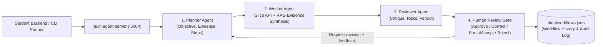

# Multi-Agent Server (`:5004`) — Non-Containerised Release 2 Shared AI Service

`multi-agent-server` is the shared non-containerised local ASP.NET Core (`.NET 10`) service that coordinates the **Planner -> Worker -> Reviewer -> Human Review** workflow for Release 2.

## Architecture & Roles



1. **Planner Agent**: Decomposes the user goal into an objective, required evidence sources, and step-by-step execution plan.
2. **Worker Agent**: Gathers live slice evidence (e.g., `student-1-backend` notifications and `rag-server` grounded policies) and synthesises a draft output and recommended actions via `ai-mode` (`:5001`).
3. **Reviewer Agent**: Audits the Worker output against the Planner objective and gathered evidence, flagging risks and confidence levels before pausing at `AwaitingHumanReview`.
4. **Human Review**: Records a final decision (`Approve`, `Correct`, `PartialAccept`, or `Reject`) through the existing review endpoint. Alternatively, the revision endpoint sends human feedback back through Planner, Worker and Reviewer before another human decision. Student 1's manual-correction behaviour remains compatible.

## Endpoints

| Method | Route | Purpose |
|---|---|---|
| `GET` | `/` | Service metadata, active agent list, and stored workflow count |
| `GET` | `/health/live`, `/health/ready` | Liveness and readiness probes |
| `GET` | `/api/workflows` | List workflow history (optional `?owner=student-1&studentId=...`) |
| `GET` | `/api/workflows/{id:guid}` | Retrieve a single workflow record and its coordination audit log |
| `POST` | `/api/workflows/run` | Execute `Planner -> Worker -> Reviewer` and pause at `AwaitingHumanReview` |
| `POST` | `/api/workflows/{id:guid}/human-review` | Submit Human Review decision (`Approve`, `Correct`, `PartialAccept`, `Reject`) |
| `POST` | `/api/workflows/{id:guid}/revise` | Replan the current proposal with human feedback, retaining its workflow ID and revision history |

### Human-feedback revisions

Send `requestId` (a new UUID per correction), `expectedRevision` (initially
`0`), `reviewerName` (1-100 characters) and `feedback` (1-2000 characters).
The original goal and supplied evidence remain attached to the workflow.
Previous stage outputs and feedback are retained in `revisions`, and the
coordination audit records the new Planner, Worker and Reviewer pass.
The response increments `revision` and returns to `AwaitingHumanReview`;
it does not apply any feature-side action.

Each agent receives the latest feedback as an explicit change instruction,
separate from earlier feedback and previous outputs. It takes precedence over
conflicting earlier feedback, but not mandatory output constraints. Agents
should make the closest valid adaptation when necessary; the Reviewer checks
the actual revised output against the latest request and explains adaptations.

Reuse the same request ID and feedback when retrying a correction whose
response was lost. Stale or competing revisions, reused request IDs with
different feedback, and revisions after a final decision return `409`.
AI failures return `502` without replacing the previous proposal with canned
output. Revision writes are atomic; failed passes leave the previous committed
revision intact. A cancelled request may already have committed, so retries
must reuse its request ID. Existing records without revision fields load as
revision `0`.

New review callers should supply `expectedRevision` to prevent accepting a
superseded proposal. The existing human-review endpoint still supports
legacy clients that omit this field and manually provide `correctedOutput`.

## Running Locally

Launched automatically alongside `ai-mode`, `mcp-server`, and `rag-server`:
```bash
python tools/run_ai_services.py
```

Or run standalone:
```bash
dotnet run --project ai-services/multi-agent-server/MultiAgentServer/MultiAgentServer.csproj --urls http://127.0.0.1:5004
```
