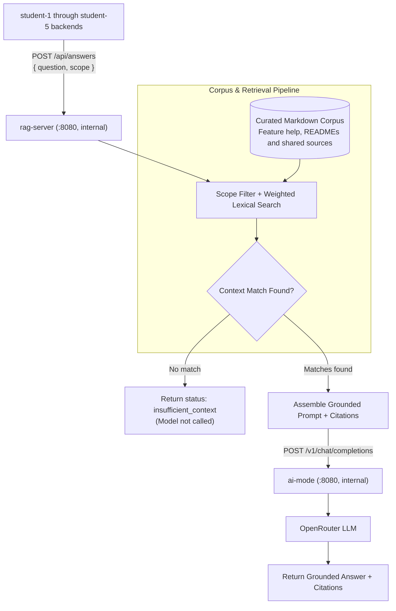

# RAG Server

Shared ASP.NET Core service for retrieval-augmented
generation. It indexes a curated, read-only Markdown corpus at startup,
retrieves relevant sections with deterministic weighted lexical search, and
sends only those sections to `ai-mode` for grounded generation through
OpenRouter.



## API

`POST /api/answers` accepts a question and an optional scope: `student-1`
through `student-5`, `shared`, or `all`. Omitting the scope defaults to
`all`; null, empty, and whitespace-only scopes also use `all`.
Questions must contain 3-500 characters after trimming. Invalid questions
or unknown scopes return `400`; gateway or generation failures return `502`,
and generation timeouts return `504`.

Feature scopes retrieve
only their `student-x/` sources and explicitly shared documentation. Shared
sources are paths under `shared/`, `AGENTS.md`,
`docs/architecture/data-flows.md`, and
`docs/knowledge-base/course_policies.md`. The `shared` scope excludes
student-specific sources; `all` searches the full curated corpus. Responses
include `status`, `answer`, `confidence`, `citations`, and `retrieval`.
Citations contain `sourceId`, `title`, `heading`, and retrieval `score`;
retrieval counts are `matchedChunks` and `consideredChunks`. Confidence is
retrieval-based (`low`, `medium`, `high`, or `insufficient`), not a guarantee
of factual accuracy. Considered chunks count only sources eligible for the selected scope.
Questions without a relevant corpus match return
`insufficient_context` without calling the model. The model can also decline
an unsupported question after retrieval.

## Feature integrations

Each frontend calls its own backend, which forwards questions to RAG.
The routes below are direct backend routes, before shell proxy prefixes.

| Caller | Backend route | Forwarded scope |
|---|---|---|
| `student-1-backend` | `POST /api/notifications/rag/query` | `student-1` by default; accepts a caller-supplied scope |
| `student-2-backend` | `POST /api/integrations/rag/query` | Fixed to `student-2` |
| `student-3-backend` | `POST /api/integrations/rag/answers` | Fixed to `student-3` |
| `student-4-backend` | `POST /api/users/help/answers` | Fixed to `student-4` |
| `student-5-backend` | `POST /api/integrations/rag/answers` | Fixed to `student-5` |

## Corpus and scopes

The image packages ten Markdown documents. Each student scope can retrieve
its own sources below plus the shared sources; `shared` retrieves only
shared sources, and `all` searches the entire corpus.

| Scope | Packaged sources | Documentation coverage |
|---|---|---|
| `student-1` | `student-1/README.md` | Notifications, delivery preferences, digests, and notification assistants |
| `student-2` | `student-2/README.md` | Automations, Canvas integration, quiz filling, and run history |
| `student-3` | `student-3/README.md`, `student-3/docs/deadline-help.md` | Deadlines, task tracking, Canvas sync, and deadline assistants |
| `student-4` | `student-4/README.md`, `student-4/docs/account-help.md` | Accounts, profiles, roles, passwords, and readiness checks |
| `student-5` | `student-5/README.md` | Grades, progress tracking, and what-if calculations |
| `shared` | `AGENTS.md`, `docs/architecture/data-flows.md`, `docs/knowledge-base/course_policies.md` | Architecture, cross-service flows, and documented course policies |

Citations are built from retrieved chunks, not model-supplied source names.
RAG answers documentation questions; it does not query live tasks, accounts,
notifications, or grades, and cannot execute actions. Private records and
credentials are not part of the corpus. A vector store or embedding service
is deferred until corpus size or retrieval quality justifies it.

## Running

Start the shared AI services from the repository root:

```bash
docker compose up --build -d ai-mode mcp-server rag-server
```

There is no published host port. Callers on the `ai-services` network use
`http://rag-server:8080`.
The image contains only the curated Markdown sources under `/app/Corpus`;
it does not mount the repository, secrets, or feature databases. RAG runs
as a non-root user and calls `http://ai-mode:8080` without an OpenRouter key.
After editing corpus sources, run `docker compose up --build -d rag-server`
to refresh the packaged documents and startup index.
