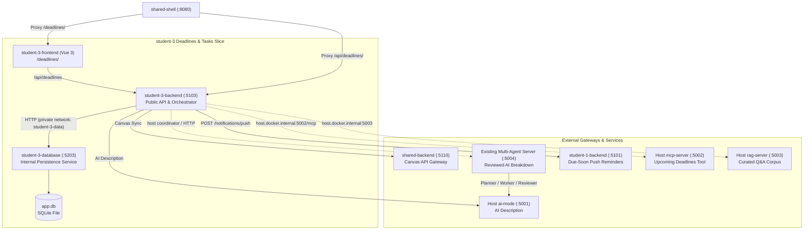

# Deadline and task-tracker service

The service manages courses, tasks, subtasks, priorities, completion states,
due dates, and task filtering. Its Vue frontend provides task-list,
monthly calendar, upcoming-task, and Canvas assignment planning views using
the shared Better Canvas UI kit. Persisted timestamps use `DateTime` normalized
to UTC. Due dates can be changed or removed explicitly; completing a parent
task also completes all of its descendants.

AI Breakdown calls the existing shared Multi-Agent Server through the
task-tracker backend. Planner, Worker and Reviewer generate a proposal,
which the student reviews before any subtasks are created. Assignment prompt
templates remain editable; assignment and course context comes from the
private persistence API. Task descriptions still call `ai-mode` and can be drafted
from a title and the selected course or parent assessment, then edited before
saving.

AI description generation and assignment breakdown are enabled by default.
Set `AI_MODE_ENABLED=false` in the root `.env` and recreate
`student-3-backend` with `docker compose up -d student-3-backend` to disable
them. For standalone execution, set `AiGateway__Enabled=false`.
The frontend reads `aiModeEnabled` from `GET /api/integrations/capabilities`
and disables/grays out both AI controls when unavailable. Direct calls to the
generation endpoints return HTTP 503 when disabled; manual task editing,
CRUD, MCP, and RAG are unaffected. Breakdown additionally requires
`MULTI_AGENT_ENABLED=true`; description generation does not.
Reload the frontend after changing the flag.

The **AI ASSIST** button below the page navigation opens a centered dialog.
Its **MCP** mode checks upcoming deadlines; **RAG**
answers documentation questions with source citations and confidence labels.
Both modes call the shared local services through the tracker backend.
MCP displays the returned tool name and structured JSON alongside readable
results; **OPEN TASK** opens the existing task editor. RAG provides sample
questions and retrieves this feature's sources, including
[Deadline Tracker Help](../docs/features/student-3/deadline-help.md), plus explicitly shared sources.
Restart `python tools/run_ai_services.py` after changing corpus documentation.

### Multi-Agent AI Breakdown

Use the existing **AI BREAKDOWN** button on an assignment. Generate a
proposal, inspect the Planner/Reviewer outputs and audit, then select and
edit the proposed tasks in the same dialog. Enter a reviewer name and
comments before saving or rejecting. There is no separate Multi-Agent tab.

Generation creates no tasks. Saving all unchanged tasks records Approve;
editing them records Correct; selecting a subset records PartialAccept.
Reject records the decision without creating anything. Accepted tasks are
created atomically through `student-3-database`. A durable workflow receipt
makes repeated saves return the original result instead of duplicating tasks.
Assignment changes require a new proposal. A recorded decision can only be
retried with the same reviewed output, reviewer and comments.

Workflows are scoped to `student-3` and the existing demo student identity;
this is not per-user authentication. Only assignment-bound workflows can be
applied to that assignment.

Set `MULTI_AGENT_ENABLED=true` in the root `.env` and recreate
`student-3-backend`. Compose uses the existing host-server model at
`http://host.docker.internal:${MULTI_AGENT_HOST_PORT:-5004}` and maps that
hostname to the host gateway on Linux. The host launcher listens on all
interfaces for Docker access; restrict these development ports with the host
firewall. A standalone backend uses
`MultiAgentServer__BaseUrl=http://127.0.0.1:5004`.
Set `MultiAgentServer__Enabled=true` or `false` explicitly for standalone
backend runs. Changing the shared server's deployment is deferred.

The existing server executes synchronously and does not expose live stage
progress. The dialog displays a waiting message, not simulated agent states.
The Worker is asked for compact task JSON; malformed/truncated output and
canned prose are rejected with no task writes. Reviewer text and confidence
can still be canned, so the dialog explicitly requires human checking.
Shared-server retries, real progress events and stronger output contracts
remain for the next PR. Workflow writes are not automatically retried.

`POST /api/tasks/{id}/ai-breakdown` now returns a workflow and proposed tasks,
not created tasks. `POST /api/tasks/{id}/ai-breakdown/review` takes the
workflow ID, selected task indices/edits, reviewer name/comments and a reject
flag. It returns the human-reviewed workflow and any created tasks.
`GET /api/integrations/capabilities` exposes `aiBreakdownEnabled` separately
from `aiModeEnabled`. Disabled breakdown operations return 503; invalid
structured output/upstream failures return 502; stale/conflicting reviews
return 409.



## Standalone development

The task and course APIs need their private database service running first:

```bash
# Terminal 1: Run Database Service (default port 5203)
dotnet run --project student-3/database/Database/Database.csproj

# Terminal 2: Run Public Backend (default port 5103)
dotnet run --project student-3/backend/Api/Api.csproj
```

The API reads `DatabaseService:BaseUrl`, which defaults to
`http://localhost:5203` — the database service's standalone URL.

In a third terminal, run the frontend at
`http://localhost:3003/deadlines/`:

```bash
npm run dev --workspace=student-3-frontend
```

The frontend calls port 5103 by default, while `dotnet run` uses the `http`
launch profile on port 5014. Start the API with
`--urls http://localhost:5103` (or set `VITE_DEADLINES_API_BASE_URL`) when
running both outside Docker. Canvas sync is unavailable unless the shared
backend is also configured.

## Canvas sync

The service obtains Canvas data exclusively through the shared backend.
Docker Compose supplies `SharedService:BaseUrl` as
`http://shared-backend:8080`, using the shared service's Compose DNS name.
Canvas sync is intentionally unavailable when this service is run standalone.
AI generation is also unavailable unless `AiGateway:BaseUrl` points to a
running `ai-mode` gateway.

Start the integrated services and trigger a sync:

```powershell
docker compose up --build
```

The shared shell is then available at `http://localhost:8080/`, the task
tracker at `http://localhost:8080/deadlines/`, and its proxied API under
`/api/deadlines/`. The shell dashboard also shows the next five incomplete
tasks by due date and priority.

```http
POST /api/canvas-sync
```

Canvas course and assignment IDs have unique database constraints. Repeated
syncs update the same course/task, including task completion when Canvas reports
a submission as submitted or graded. Other submission states do not overwrite
the task's local status. Assignments no longer returned by Canvas are retained
with `canvasIsActive: false`. Normal task and course list requests hide inactive
Canvas records unless `includeInactiveCanvas=true` is provided.

Canvas assignment descriptions are converted from untrusted HTML to readable
plain text by the shared Canvas service before they reach the tracker. Paragraph,
line-break, list, table, and image-alt text is preserved; executable and embedded
content is discarded. The tracker never renders Canvas HTML.
